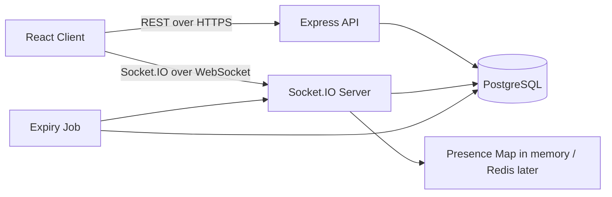
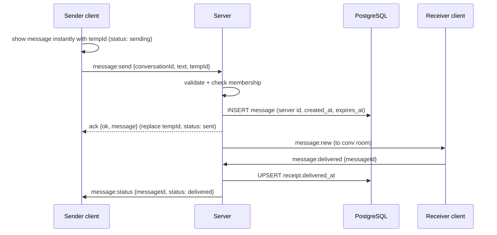

# 04. Architecture

## Components

- **REST** is used for things that are request/response: login, loading history, searching users, creating groups, uploading files.
- **Socket.IO** is used for live events: new messages, typing, presence, status, reactions, expiry.
- Both run in the same Node process and share the same service layer (so logic is not duplicated).

## Rooms strategy
- On connect (after auth), the server auto-joins the socket to:
  - a personal room `user:{userId}` (for notifications to all of that user's tabs)
  - a room `conv:{conversationId}` for every conversation the user belongs to
- Broadcasting to a chat = `io.to("conv:{id}").emit(...)`.
- When a user is added to a new conversation, the server makes their sockets join that room immediately.

## Message flow (happy path)

## Offline receiver
1. Message is saved in the DB regardless of who is online.
2. When the receiver connects, the client calls `GET /conversations` and `GET /conversations/:id/messages` (REST) to catch up.
3. Right after connect, the server marks all undelivered messages for that user as delivered and emits `message:status` to senders.
4. The client never relies on sockets alone for history. **Sockets are for live updates; the DB is the truth.**

## Presence
- Server keeps `Map<userId, Set<socketId>>`.
- First socket for a user = online (emit `presence:update` online). Last socket disconnects = offline, set `users.last_seen_at`, emit offline.
- Presence is sent only to users who share a conversation with that user.

## Self-destruct design
- Server stores `expires_at` per message.
- Cleanup job runs every 5 seconds: find messages where `expires_at <= now` and not yet expired, clear body, set `expired_at`, emit `message:expired` to the conv room.
- All message queries filter out or blank expired bodies, so an offline client can never read an expired body.
- Client may also hide the message locally at `expires_at` for smooth UX, but the server decides truth.

## Reconnection
Socket.IO reconnects automatically. On `connect`, the client must: re-fetch the open chat's messages since the last known message (`?after=`), and refresh the chat list. Do not assume missed events were replayed.

## Scaling notes (documented only, build later)
- Multiple servers need the Socket.IO **Redis adapter** so broadcasts reach all servers.
- Presence moves from in-memory map to Redis.
- The expiry job must run on one node (or use BullMQ with Redis) to avoid duplicate emits.
