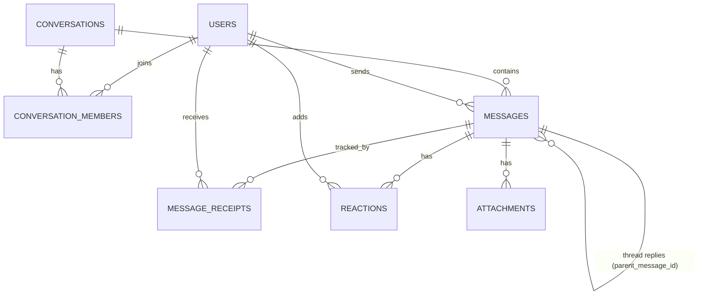

# 05. Database Schema (PostgreSQL + Prisma)

## Tables

### users
| Column | Type | Notes |
|---|---|---|
| id | uuid PK | |
| username | text unique | 3-20 chars, lowercase |
| email | text unique | |
| password_hash | text | bcrypt |
| display_name | text | |
| avatar_url | text null | |
| about | text null | |
| last_seen_at | timestamptz null | |
| created_at | timestamptz | default now() |

### conversations
| Column | Type | Notes |
|---|---|---|
| id | uuid PK | |
| type | enum('direct','group') | |
| name | text null | groups only |
| direct_key | text null unique | for direct: `smallerUserId:largerUserId`, prevents duplicate DMs |
| created_by | uuid FK users | |
| created_at | timestamptz | |
| last_message_at | timestamptz | for sorting chat list |

### conversation_members
| Column | Type | Notes |
|---|---|---|
| conversation_id | uuid FK | |
| user_id | uuid FK | |
| role | enum('admin','member') | |
| joined_at | timestamptz | |
| last_read_message_id | uuid null | for unread counts |
PK: (conversation_id, user_id)

### messages
| Column | Type | Notes |
|---|---|---|
| id | uuid PK | server generated |
| conversation_id | uuid FK | index |
| sender_id | uuid FK | |
| type | enum('text','image','system') | |
| body | text null | set to NULL when expired |
| parent_message_id | uuid null FK messages | thread parent; null = top-level |
| expires_in_seconds | int null | twist 1: self-destruct duration |
| expires_at | timestamptz null | set to (read_at + expires_in_seconds) when recipient reads |
| expired_at | timestamptz null | when cleanup actually ran |
| client_temp_id | text null | echoed back for optimistic UI |
| created_at | timestamptz | default now() |

Indexes: `(conversation_id, created_at DESC)`, `(parent_message_id)`, `(expires_at) WHERE expired_at IS NULL`.
Rule: thread depth is one level. Reject a reply whose parent already has a parent.

### message_receipts
| Column | Type | Notes |
|---|---|---|
| message_id | uuid FK | |
| user_id | uuid FK | the recipient |
| delivered_at | timestamptz null | |
| read_at | timestamptz null | |
PK: (message_id, user_id)

### reactions
| Column | Type | Notes |
|---|---|---|
| message_id | uuid FK | |
| user_id | uuid FK | |
| emoji | text | one of the allowed set |
| created_at | timestamptz | |
PK: (message_id, user_id, emoji) so duplicates are impossible.

### attachments
| Column | Type | Notes |
|---|---|---|
| id | uuid PK | |
| message_id | uuid FK | |
| url | text | |
| mime_type | text | |
| size_bytes | int | |

### refresh_tokens
| Column | Type | Notes |
|---|---|---|
| id | uuid PK | |
| user_id | uuid FK | |
| token_hash | text | store a hash, never the raw token |
| expires_at | timestamptz | |
| revoked_at | timestamptz null | |

## Notes for the coding agent
- Write this as `server/prisma/schema.prisma`, then run a migration.
- Add a seed script creating 3 demo users and 1 group.
- Compute message status per message from receipts (see doc 12).
