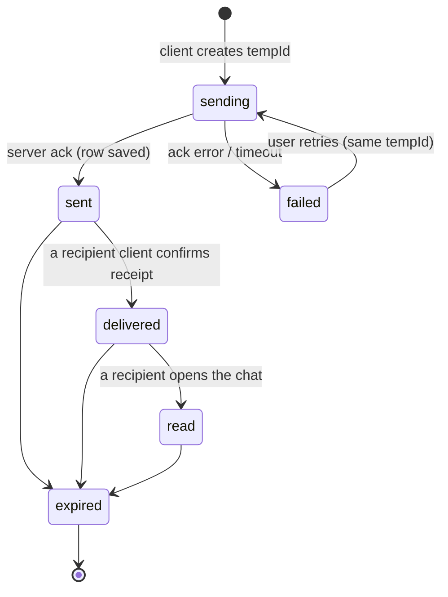

# 12. Message Lifecycle

This is the trickiest logic in the app. Follow it exactly.

## States of a message (sender's view)

`sending` and `failed` exist only on the client. Server states: sent, delivered, read, expired.

## Computing status from receipts
- Direct chat: one recipient. status = read if `read_at` set; else delivered if `delivered_at` set; else sent.
- Group: status = read only if **all** other members have `read_at`; delivered if all have `delivered_at`; else sent.
- Receipt rows are created for every other member when the message is created.

## Delivery rules
1. User online and in the room: server emits `message:new`; client replies `message:delivered`; server sets `delivered_at` and tells the sender.
2. User offline: nothing happens now. The message waits in the DB.
3. On the user's next socket connect: server finds receipts with `delivered_at IS NULL` for that user, sets them, and emits `message:status` to each sender's `user:{id}` room.
4. Read: when the user has the chat open and focused, the client sends `message:read {upToMessageId}`; server sets `read_at` (and `delivered_at` if missing) for all earlier messages.
5. Never downgrade a status. Operations are idempotent.

## Self-destruct rules
- When sent, `expires_in_seconds` is recorded. `expires_at` is initially `NULL`.
- When the recipient reads the message (`message:read`), `expires_at = read_at + expiresInSeconds` is computed on the **server** (for groups, upon first read by any non-sender member).
- The cleanup job (every 5 s) selects `expires_at IS NOT NULL AND expires_at <= now() AND expired_at IS NULL`, sets `body = NULL`, `expired_at = now()`, deletes attachments' files, emits `message:expired`.
- Reads and history queries: if `expired_at IS NOT NULL` **or** `expires_at <= now()`, return `expired: true` and `body: null`, even if the job has not run yet.
- Expired messages keep their row (for thread counts and ordering) but have no content.
- Reactions on expired messages are removed or ignored.
- A parent message that expires keeps its thread; replies remain.

## Idempotency
`UNIQUE(sender_id, client_temp_id)`. If the same pair arrives again, return the existing message and do not re-broadcast.

## Edge cases to handle and test
- Two tabs of the same user: both receive `message:new`; delivered is recorded once.
- Message sent exactly as the receiver reconnects.
- Clock differences: client countdown uses `expiresAt` minus (server time offset); server decides truth.
- User removed from a group: stops receiving events and can no longer fetch history.
- Reply sent to a parent that has just expired: allowed, but the parent shows the placeholder.
